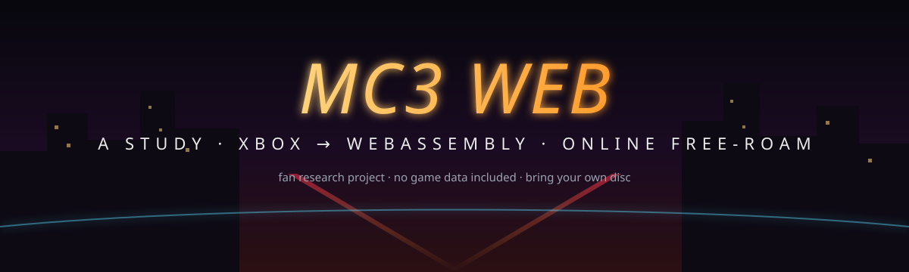
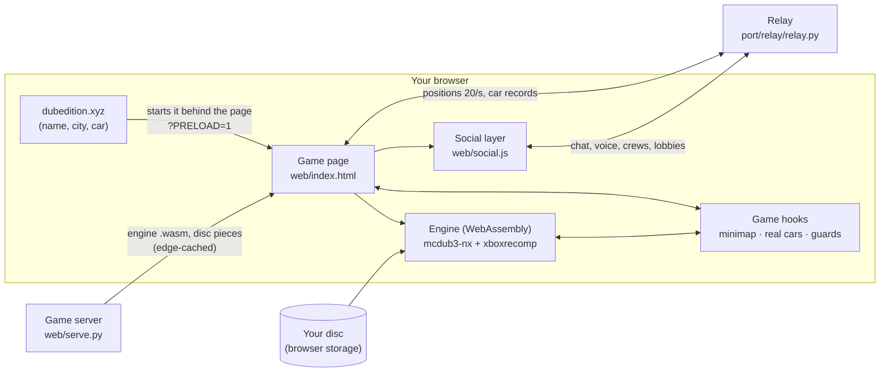
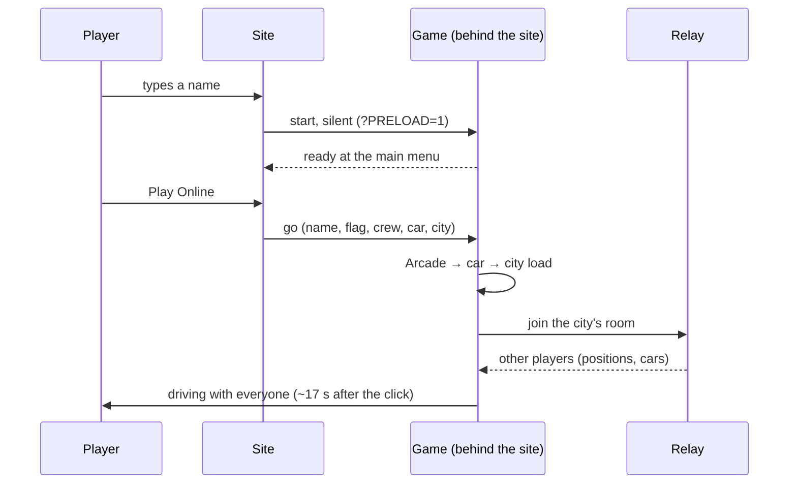

<p align="center"></p>

<p align="center">
  <a href="https://dubedition.xyz"></a>
  <a href="https://discord.gg/shTwPRGX7f"></a>
</p>
<p align="center">
  
  
  
  
  
</p>

**MC3 Web** is a study: taking *Midnight Club 3: DUB Edition*, already statically recompiled from the
original Xbox disc to C by [mcdub3-nx](https://github.com/laureladastra/mcdub3-nx) and
[xboxrecomp](https://github.com/sp00nznet/xboxrecomp), and making it run **in a web browser**, with
**online free-roam** for everyone in the same city. This repository is the complete source, so anyone can
read how it was done, learn from it, and build their own.

> [!WARNING]
> **No game is included.** There are no game files, textures, sounds, models, maps or executables in
> this repository. You need your own copy of the original Xbox disc. *Midnight Club 3: DUB Edition* is
> © Rockstar Games / Take-Two Interactive. This is a non-commercial fan study, not affiliated with or
> endorsed by them.

## 🎮 Play and test it

| | |
|---|---|
| **Play in your browser** | **[dubedition.xyz](https://dubedition.xyz)**: type a name, pick a city, press **Play Online**. Chrome, Edge, Brave or Firefox on a computer, keyboard or controller. |
| **Community, bug reports, suggestions** | **[Discord](https://discord.gg/shTwPRGX7f)**: the `#bug-reports` and `#suggestions` forums. In the game, **F9** sends a problem report with the game's log. |
| **Controls** | W/S gas and brake, A/D steer, Space handbrake, Left Shift nitro, C look back, V camera. Online: **M** map and players, **T** chat, **N** push-to-talk, **1–8** quick chat. |

## ✨ What the study achieved

- 🌐 **The whole game in a browser tab**: WebAssembly with threads, WebGL 2 rendering of the Xbox GPU's
  commands, Web Audio for the Xbox sound chip, keyboard and controllers. No plugin, no download step.
- 🏙️ **Online free-roam**: everyone in San Diego, Atlanta or Detroit drives in one city. Other players appear
  on the game's own minimap and **as real cars** (their model and paint, wheels that spin and steer),
  with name tags, flags and crews.
- 💬 **Social layer**: text chat (room, crew, nearby), proximity and crew voice, crews, meet-ups, lobbies,
  "join a friend" teleport, shared weather, a simple speed anti-cheat.
- ⚡ **Fast start**: the engine and disc stream as small edge-cached pieces; the website starts the game
  behind its own page once you type your name, so **Play Online → driving takes about 17 s**.
- 💾 **Your disc, your saves**: the disc image is read in the browser (XDVDFS) and kept in the browser's
  private storage; saves stay there too, with backups and download/import.

## 🧭 How it works





## 🛠️ Build your own

You need **your own Xbox disc** of the game, Linux or WSL2 (Ubuntu 24.04 was used), Python 3,
[Emscripten](https://emscripten.org/docs/getting_started/downloads.html) (built with emsdk 7.0.0), CMake and Ninja.

```bash
# 1. the source
git clone https://github.com/clydejuniorscripts/mc3-web-study && cd mc3-web-study

# 2. the toolchain: Python venv and build deps (see docs/mcdub3-nx-README.md and CONTRIBUTING.md)
make setup
git clone https://github.com/emscripten-core/emsdk ~/emsdk && ~/emsdk/emsdk install latest && ~/emsdk/emsdk activate latest

# 3. your disc: extract it into game/ (default.xbe + its files)
make extract ISO=/path/to/your-disc.iso             # or copy the files from your own disc into game/

# 4. lift the game to C (generated into work-dub/, never committed)
make lift

# 5. build the WebAssembly engine -> work-dub/build-web/mcdub3.js + .wasm
bash web/build_web.sh

# 6. serve it and open http://localhost:8099
python3 web/serve.py --port 8099

# 7. optional: online play on your own relay, then open http://localhost:8099/?RELAY=ws://localhost:8090
python3 port/relay/relay.py --port 8090
```

Optional pictures used by the web page, made from **your** disc with the tools in `port/`:
`port/tools_decode_hudmap.py` (the city maps for the M map), `port/tools_icons.py` (map icons),
`port/tools_novideo.py` (short intro videos). The page works without them.

The game hooks are already installed in `src/games/dub/recomp_manual.c`; their readable source is
`port/minimap_ghosts.inc.c` (`port/install_minimap_ghosts.sh` puts it in place after edits; then
`LIFT_ONLY=1 tools/regen.sh` and `web/build_web.sh` again).

## 📁 What's where

| Path | What it is |
|---|---|
| `src/`, `config/`, `tools/`, `docs/`, `android/`, `switch/` … | [mcdub3-nx](https://github.com/laureladastra/mcdub3-nx) with this port's changes (the Emscripten build in `CMakeLists.txt`, `src/main.c`, the hooks in `recomp_manual.c`). Upstream's README is in `docs/mcdub3-nx-README.md`. |
| `xboxrecomp/` | [xboxrecomp](https://github.com/sp00nznet/xboxrecomp) with this port's changes: WebGL renderer work, the sound-chip stereo downmix, the memory-window and bus-tag fixes, the USB (OHCI) ordering fix, the network-card model (`src/usb/nvnet.c`). |
| `web/` | The game page (`index.html`), the game server (`serve.py`), the social layer (`social.js`), the Emscripten glue (`pre.js`, `web_host.c`), the disc importer, the build script. |
| `port/relay/` | The multiplayer relay: WebSocket rooms, chat, voice, crews, lobbies, anti-cheat, tests and load-test bots. |
| `port/` | The study's notebook: the game hooks' source, the patch scripts applied along the way, and the reverse-engineering, profiling and test tools. Scripts there assume the paths of the machine they were written on. |

## 📚 What I learned

**1. A browser has no hardware traps, so devices have to be polled.** Recompiled Xbox code talks to its
GPU, sound chip, USB controller and network card through memory-mapped registers. A PC emulator traps those
accesses; WebAssembly can't. Every device became a thread that watches its registers and rings. Timing
between those threads and the game is where most of the hard bugs lived.

**2. "Make the memory bigger" breaks every hidden assumption.** Doubling the guest memory to 128 MB (so other
players' cars fit) made the sound distorted and caused freezes: a tag bit (`0x04000000`) that marked
"ordinary RAM" in device addresses had been chosen as "above any address 64 MB can produce". With 128 MB it is
a real address bit, so the sound chip, USB controller and GPU read buffers above 64 MB from the wrong place.
One constant, three symptoms.

**3. Freezes were races, found by dumping every thread.** A watchdog logs each guest thread's last kernel call,
its stack and the guest-lock holder after 12 s without a frame. The worst freeze family came from the emulated
USB controller advancing its frame clock *before* walking its lists, so the game freed transfer descriptors
still being walked. Reordering one step removed every variant (3 of 7 boots froze before, 0 of 4 after).

**4. The sound chip's effects processor matters even when you don't emulate it.** A pass-through DSP summed all
32 mix bins. The game also sends its full-range engine sound to the subwoofer bin, so the engine was doubled. A
real stereo downmix (front + 0.71 × centre/rear + the 3D pairs + only the LFE's low end) fixed it. Measuring
per-bin loudness first showed it.

**5. Loading fast on the web is a caching problem.** Cloudflare doesn't edge-cache `.wasm` or Range requests, so
the engine is a versioned `.bin` and the disc fixed 64 KB pieces. A boot's pieces are recorded and fetched in
parallel. The site and game host are the same *site*, so they share the HTTP cache — and the site, made
cross-origin isolated (COOP + COEP `credentialless`), starts the game itself behind its page.

**6. Browsers slow down anything you can't see.** Hidden tabs and frames lose `requestAnimationFrame`. Anything
that must keep running (sending your position) can't depend on the repaint loop, and a preloaded game must
stay painted, behind the page.

**7. Online play can live outside the game's netcode.** Free-roam didn't need System Link: the page reads each
player's position from a hook, sends it over a WebSocket relay, and writes the others into a table the game
draws — arrows on its minimap, then real cars built with the game's own car factory and destroyed the game's
way before every load. The relay never sees game data.

**8. Driving menus from outside means reading the game's UI and scaling every wait.** The front end is a Flash
movie whose labels and cursor live in memory. Fixed waits worked at 30 fps and failed at 5 fps; every wait now
scales with the frame time.

**9. Many agents on one machine need rules.** The port was built with several Claude Code sessions in parallel.
Two copies of the game on one PC distort each other's sound and frame rate, so: one game copy at a time, 60 s
of quiet before a test boot, one session holds the engine build, test on the live site.

## 🙏 Credits

This stands entirely on other people's work — see **[CREDITS.md](CREDITS.md)**: Laure Ladastra (mcdub3-nx),
Ned Heller and the xboxrecomp contributors, the xemu authors (espes, Jannik Vogel, Matt Borgerson),
Fabian Giesen, nfsu2-sw, and everyone who played the public test.

Study by **Clyde Junior** — [@clydejuniordev](https://x.com/clydejuniordev) · [dubedition.xyz](https://dubedition.xyz) ·
[Discord](https://discord.gg/shTwPRGX7f). Built with [Claude Code](https://claude.com/claude-code).

## ⚖️ Licence

MIT for this port's code and mcdub3-nx/xboxrecomp (see [LICENSE](LICENSE) and `xboxrecomp/LICENSE`). The
sound-chip files from xemu inside `xboxrecomp/src/apu/` stay **LGPL-2.1-or-later** — see [NOTICE.md](NOTICE.md)
and `xboxrecomp/NOTICE`.
